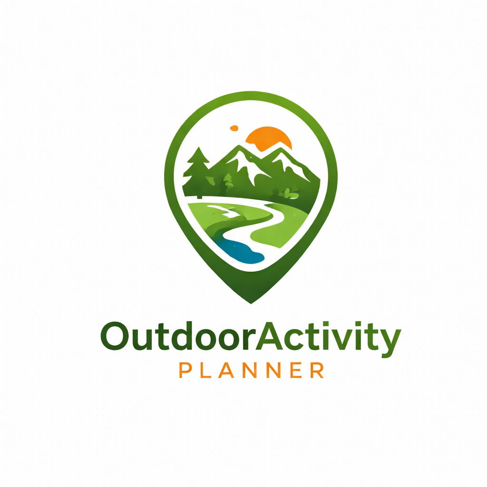

  

  <h1>OutdoorActivityPlanner</h1>

  

    Applicazione per la creazione e pianificazione di percorsi outdoor
  

---

## 📌 Descrizione

OutdoorActivityPlanner è una web app progettata per consentire agli utenti di creare, visualizzare e gestire percorsi outdoor in modo semplice e intuitivo.

L’app permette di disegnare itinerari su mappa, organizzare attività all’aperto e pianificare esperienze personalizzate, offrendo uno strumento efficace per escursioni, sport e viaggi.

---

## 🏗️ Architettura

## 📚 Documentazione

Per ulteriori informazioni sul progetto è disponibile nella Wiki GitLab.
In particolare:
- Integrazione con OpenStreetMap e OpenRouteService
- Gestione dei waypoint e dei percorsi

👉 [Consulta la Wiki](https://gitlab.com/santin_colombo/outdooractivityplanner/-/wikis/Wiki-resources)